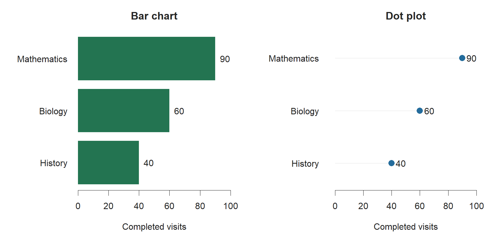
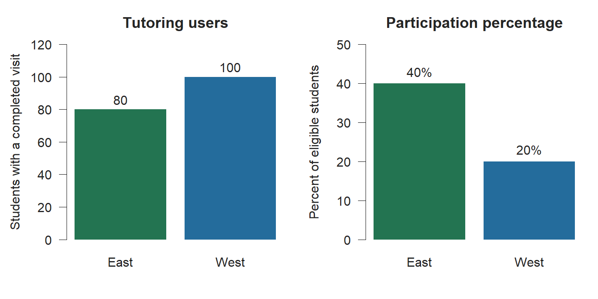
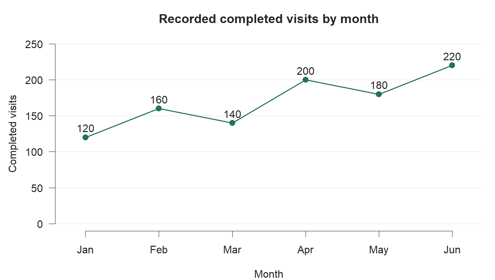
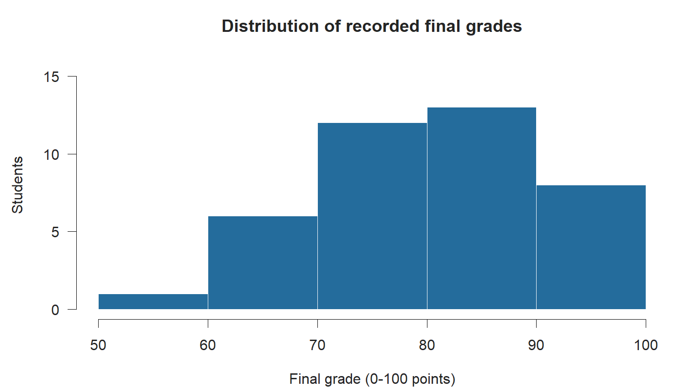
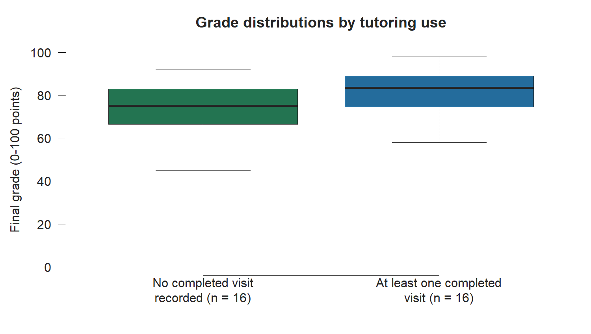
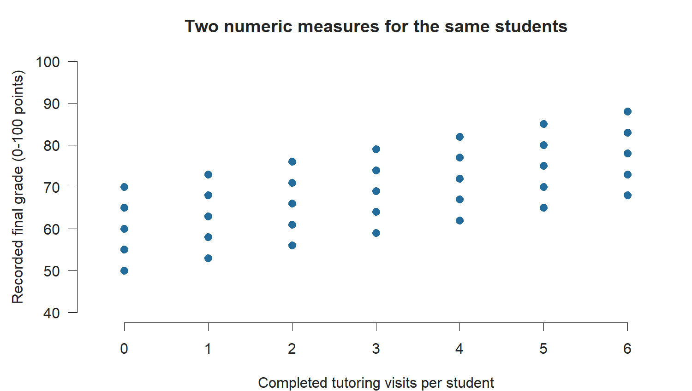
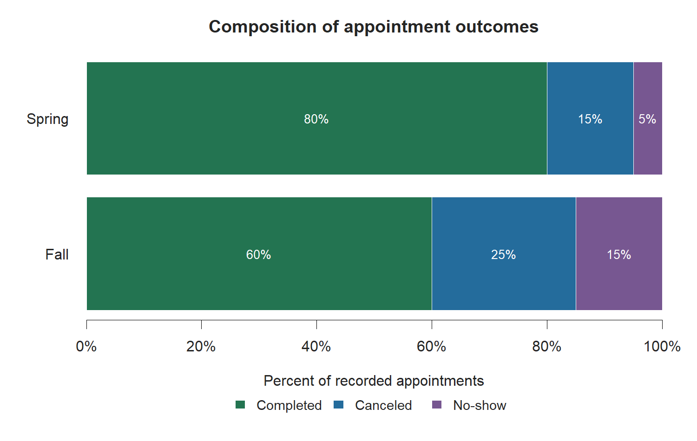

# Choosing a chart

Mini-Project 1 used a table to answer a focused audience question. The next part of the course adds charts. A chart can help readers notice a difference, follow a pattern over time, or inspect the distribution of a numeric measure. Choosing the chart begins with what readers need to see.

Suppose a tutoring director asks which subject has the most completed visits. A bar chart can make that comparison easy to see. If the director instead asks how visits changed during the semester, a line chart answers a different question. Both may use the same appointment file, but they require different summaries and different visual forms.

In this chapter, you will learn how to choose a chart from an audience task, identify the variables it needs, and explain what the chart can support. The next chapter will cover building figures in Quarto.

::: {.callout-note title="About the examples"}

All figures in this chapter use illustrative data created for teaching. Their values are not findings about an actual tutoring program. Each example demonstrates a chart-choice decision. The R script that generates the figures is saved with the chapter assets.

:::

## Begin with the audience's question

Before selecting a chart, write the question in ordinary language. Then describe what the reader needs to do with the evidence.

For example:

> The tutoring director needs to compare completed visits across subjects to understand recorded service demand.

This sentence identifies a comparison task. It also defines the measure as completed visits. Counting all scheduled appointments would answer a different question.

An audience task might be to compare categories, follow change over time, inspect a distribution, examine a relationship, or understand parts of a whole. A chart should make that task easy to perform.

| Audience question | Task | Evidence needed |
| --- | --- | --- |
| Which subject had the most completed tutoring visits? | Compare categories. | Completed-visit count for each subject. |
| How did completed visits change from January through June? | Follow change over time. | Counts for comparable monthly periods. |
| How were final grades distributed? | Inspect a distribution. | Recorded grades for the students being described. |
| How did grade distributions differ by tutoring use? | Compare distributions. | Grades and a defined tutoring-use group for each student. |
| How did visit count vary with final grade? | Examine a relationship. | Both measures for the same students. |
| What share of appointments were completed, canceled, or no-shows? | Understand parts of a whole. | Outcome counts with a defined appointment denominator. |

The subject of the data does not determine the chart. The audience's question and the required evidence determine the choice.

## Separate exploration from explanation

Charts can be used during analysis or in a final communication.

An exploratory chart helps the analyst investigate a question: Are values concentrated in one range? Do two groups differ? Are there gaps in the time series? Several exploratory charts may be needed before the analyst understands what the source can show.

An explanatory chart is selected and prepared for an audience. It focuses on a supported finding or comparison and includes the definitions needed to read it.

For example, an analyst may inspect a histogram of grades, a scatterplot of visits and grades, and a count chart by subject. A memo about appointment staffing might ultimately use the subject counts. The other charts helped the analysis but may have no role in that particular communication.

::: {.callout-tip title="State the chart's job"}

Write one sentence before making the figure: "This chart will help the reader compare completed-visit counts across subjects." If the sentence is difficult to write, revisit the audience question and measure before choosing a form.

:::

## Check the meaning of the variables

A chart combines variables with visual marks. Check what each variable measures before deciding how to display it.

A categorical variable identifies a group, label, or class. Subject, campus, and appointment outcome are categorical variables. Some categories have a meaningful order, including levels of agreement or ordered rating categories.

A numeric variable measures a quantity. Completed visits, waiting minutes, and grades on a defined scale are numeric variables. An identifier can contain digits without measuring an amount. A student identifier of `1042` is a label; it should not be averaged or placed on a quantitative axis as if it measured performance.

A time variable provides chronological position. Dates and months can be used to show a trend when the observations refer to comparable periods and the axis preserves their order.

Also determine what one observation is. One appointment, one student, and one student-course enrollment can produce different counts and comparisons. The choice made in the analysis must carry into the chart's labels and interpretation.

## How a chart encodes a value

A chart uses visible properties to convey quantities. These properties are called visual encodings.

In a bar chart, bar length communicates the value. In a dot plot, the dot's position on an axis communicates the value. A scatterplot places each observation using two numeric coordinates. In a pie chart, slice angle and area communicate a share of the whole.

Think about the comparison the reader will perform. Comparing values along a shared axis often makes differences easier to judge than comparing angles or areas. That is one reason bar charts and dot plots are useful for category comparisons.

The axis also defines the quantity. A bar labeled "100" might mean 100 appointments, 100 unique students, or 100 visits per 1,000 students. The visual form cannot supply a definition that is missing from the analysis.

::: {.callout-warning title="Select the measure before selecting the shape"}

A suitable chart can still communicate the wrong result if it displays the wrong measure. Decide whether the question needs a count, percentage, rate, average, or distribution, and establish its units and denominator before designing the chart.

:::

## Compare categories with a bar chart or dot plot

Use a bar chart or dot plot when readers need to compare numeric summaries across discrete categories.

Examples include completed visits by subject, participation percentages by campus, and median waiting time by service location. These use different measures but share a comparison task.

::: {.example title="Example 12.1: Completed visits by subject"}

A tutoring director wants to compare recorded demand across subjects. The illustrative source contains 40 completed history visits, 60 biology visits, and 90 mathematics visits.

{#fig-category-comparison fig-cap="A bar chart and dot plot answer the same category-comparison question. Values are illustrative." fig-alt="A bar chart and a dot plot each show 40 history visits, 60 biology visits, and 90 mathematics visits on a shared completed-visit scale."}

Both forms make the ranking visible. The bar chart uses lengths from zero. The dot plot places each value on the same scale. Neither connects the subjects with a line because the categories have no continuous path between them.

A supported interpretation is: "Mathematics had the most recorded completed visits in this example." That count does not measure total unmet need or the percentage of students using tutoring in each subject.

:::

Horizontal bars are useful when category labels need room. Categories can be ordered by value when ranking is the task, or by a meaningful category order when the order itself needs to be read.

Bar length is read from its baseline, so a zero baseline is the normal choice for an ordinary bar chart. A dot plot conveys position and can use a restricted range when it is labeled appropriately. Later chapters will examine scales and misleading comparisons in more detail.

## Counts and percentages answer different questions

A count describes the amount recorded. A percentage describes a share of a defined whole. Different group sizes can produce different rankings for those two measures.

Suppose the audience asks which campus had more students using tutoring. A count is appropriate. If the audience asks which campus had a higher participation share, the chart needs a numerator and denominator for each campus.

::: {.example title="Example 12.2: Two campus questions"}

In an illustrative semester, East campus had 80 tutoring users among 200 eligible students. West campus had 100 users among 500 eligible students. A tutoring user is a student with at least one completed visit during the semester.

West had the larger number of users: 100 compared with 80. East had the higher participation percentage: 80 divided by 200 is 40%, while 100 divided by 500 is 20%.

{#fig-counts-percentages fig-cap="Changing the measure changes the question and the ranking. Eligible-student denominators are 200 at East and 500 at West. Values are illustrative." fig-alt="East has 80 tutoring users out of 200 eligible students, or 40 percent. West has 100 users out of 500 eligible students, or 20 percent. West leads in count; East leads in participation share."}

A count chart answers the first question. A percentage chart answers the second. Each is defensible when its measure fits the question and its denominator is stated.

:::

Repeated visits are another measure. If one student has five completed appointments, that student contributes five visits but only one tutoring user. A visit rate and a student participation percentage need different numerators and labels.

## Follow change over time with a line chart

A line chart is useful when the audience needs to follow a numeric measure across ordered time points. The connecting line draws attention to the sequence.

Possible measures include completed visits by month, a monthly unemployment rate, or weekly average waiting time. The meaning of the time interval belongs in the source note or caption.

{#fig-monthly-trend fig-cap="Monthly completed visits in an illustrative six-month period. Each point is a monthly total." fig-alt="Completed visits are 120 in January, 160 in February, 140 in March, 200 in April, 180 in May, and 220 in June. Visits increase between January and June, with intervening decreases."}

The figure supports this statement:

> Recorded completed visits were higher in June than in January, although the count decreased in March and May.

It does not support the statement that visits increased every month.

The analyst should also ask whether the periods cover comparable service opportunities. Monthly totals may differ partly because of the number of operating days. If the audience asks about daily workload, a measure per operating day may answer that question better than a monthly count.

A line across time does not identify the cause of a change. It shows the recorded sequence. Evidence about an intervention or policy requires an appropriate design and context.

## Inspect a distribution with a histogram

A distribution describes how values are spread across their possible range. A mean or median summarizes part of that information, but it does not show how many observations lie in different ranges.

A histogram groups numeric observations into intervals, often called bins, and displays the frequency in each interval. Readers can inspect concentration, spread, and the shape of the distribution.

{#fig-score-distribution fig-cap="A histogram of 40 illustrative recorded grades on a 0-100 point scale, grouped in equal-width ten-point intervals." fig-alt="Histogram of 40 recorded grades: 1 in 50-59, 6 in 60-69, 12 in 70-79, 13 in 80-89, and 8 in 90-99."}

A histogram answers a question about one numeric variable's distribution. It can show whether the observations are concentrated in one range or extend across a broad range. The choice of bin width affects what readers see and should be appropriate to the measure and task.

A bar chart and histogram may both contain rectangular marks, but their meanings differ. A bar chart compares categories. A histogram groups a numeric scale into intervals. The order and interval widths carry meaning in a histogram.

## Compare distributions with a boxplot

When the audience needs to compare numeric distributions across groups, a boxplot can summarize each group's center and spread in a compact form.

The line inside the box shows the median. The box extends from the first quartile to the third quartile, covering the middle portion of the observations. Whiskers extend according to the rule used by the plotting method. Points beyond them identify values outside that rule; they do not automatically indicate errors.

{#fig-group-boxplots fig-cap="Boxplots compare illustrative grade distributions for two groups of 16 students. Whiskers use the standard R rule of extending to observations within 1.5 interquartile ranges of the box." fig-alt="Two boxplots compare final grades. The median is 75 for students with no completed visit recorded and 83.5 for students with at least one completed visit. Each group has 16 students, and their observed score ranges overlap."}

The figure supports a group comparison of the distributions shown. It does not say that every student in one group scored higher than every student in the other group.

A boxplot also omits details about individual observations and the distribution's shape. Its value comes from the task: it provides a compact comparison of medians and spread. If the audience needs individual values or a fuller view of shape, another display may be needed.

## Examine a relationship with a scatterplot

A scatterplot displays two numeric variables measured for the same observations. One variable determines horizontal position and the other determines vertical position. Each point is an observation.

For a tutoring question, each point could be one student, with completed visit count on the horizontal axis and recorded final grade on the vertical axis.

{#fig-visits-grades fig-cap="An illustrative scatterplot uses paired visit counts and grades for 35 students. The points were generated to demonstrate chart form, not to estimate a tutoring effect." fig-alt="Scatterplot of 35 illustrative students. Visit counts range from 0 to 6 and grades from 50 to 88. Five students appear at each visit count; grades tend to be higher at larger visit counts."}

A scatterplot can reveal direction, spread, clusters, or other patterns in paired measurements. It also lets readers see that observations with the same visit count can have different grades.

Both measures must describe the same units. A list of appointment totals for departments and an unrelated list of student grades cannot be paired to produce a meaningful student-level scatterplot.

A pattern between visits and grades does not establish why it exists. A claim that tutoring produced the grades would need evidence beyond the displayed relationship.

::: {.callout-note title="Group summaries and student observations are different"}

A chart of average grades by tutoring-use group shows group summaries. A scatterplot of visits and grades shows paired values for individual students. Decide which level of evidence the question needs, and label the units accordingly.

:::

## Show parts of a defined whole

Part-to-whole questions ask how a total is divided among categories. The categories and denominator must make that total meaningful.

If appointment outcomes are completed, canceled, and no-show, a 100% stacked bar can show the share assigned to each outcome. The displayed categories need to cover the stated whole without counting an appointment in multiple outcomes.

{#fig-appointment-composition fig-cap="Illustrative appointment-outcome shares for two terms. Each bar totals 100% of recorded appointments in that term; the terms' appointment counts are not shown." fig-alt="Fall appointments are 60 percent completed, 25 percent canceled, and 15 percent no-show. Spring appointments are 80 percent completed, 15 percent canceled, and 5 percent no-show. Each term's shares sum to 100 percent."}

Readers can compare the completed share from the common zero baseline. Interior segments are harder to compare because they begin at different positions. If the audience's main task is to compare every outcome across terms, grouped bars or a table may be more suitable.

A 100% stacked bar shows composition. It hides the difference in total appointment volume. An 80% completed share could come from a much smaller appointment total than a 60% share. Include counts when the audience also needs service volume.

A pie chart can show a few parts of one whole, but close shares are difficult to compare by angle. A bar chart is often easier to read when the question is which category is larger or how much larger it is.

## Know when a table answers the task

Charts help readers see patterns. Tables help readers look up exact values and inspect several measures for a named group.

An audience checking counts, percentages, and denominators for a specific campus may benefit from a table. An audience comparing participation shares across several campuses may benefit from a bar chart.

The two forms can be used together when each has a distinct job. For example, a chart can show the ranking and an accompanying table can provide exact counts and denominators. Every display should earn its place by helping the audience answer the question.

## Match the visual claim to the evidence

A chart makes some patterns easy to notice. The written claim still needs to fit the source and analysis.

| Visual finding | Supported wording | Evidence still needed for a stronger claim |
| --- | --- | --- |
| One subject's bar is longest. | Mathematics had the most recorded completed visits. | A demand or need claim requires information about eligible students and unrecorded need. |
| A line ends higher than it begins. | The recorded count was higher in June than in January. | An explanation for the change requires evidence about the proposed cause. |
| One boxplot has a higher median. | The displayed group had the higher median recorded grade. | A tutoring-effect claim requires a design that addresses other group differences. |
| Scatterplot values tend to rise together. | Higher visit counts tended to occur with higher recorded grades in the displayed data. | Causation requires evidence beyond the observed relationship. |
| The completed share is larger. | A larger share of recorded appointments was completed in Spring. | A workload claim also needs appointment totals and comparable coverage. |

The shape of a chart cannot make a descriptive source support a causal conclusion.

## Write a chart-choice rationale

A chart-choice rationale explains why a form fits the audience's task and the available evidence. It should name the question and measure before describing the chart.

Include:

1. The audience and what they need to compare or understand.
2. The focused question and a supported draft claim.
3. The variables, units, observation level, and denominator when relevant.
4. The proposed chart form and the visual comparison it supports.
5. An alternative form considered and a reason for the choice.
6. A source or interpretation limit that needs to travel with the chart.

::: {.example title="Example 12.3: A chart-choice rationale"}

> A tutoring director wants to compare participation shares across campuses during the same semester. I would use a horizontal bar chart of the percentage of eligible students with at least one completed visit at each campus. The numerator is unique participating students and the denominator is eligible students at that campus. Bar lengths on a common scale would let readers compare participation shares; the axis would begin at zero. I considered a chart of user counts, but that answers a question about the number of users and can give a different ranking when campus sizes differ. The caption or accompanying table should report the campus denominators. The chart would describe recorded participation and would not measure unmet need or tutoring effectiveness.

This rationale states what the chart will show, how the audience will read it, and what the evidence will leave unanswered.

:::

## Use AI to discuss chart options

AI can suggest candidate forms when given the audience task and verified variable definitions. It may also help explain tradeoffs between a table and chart or between two chart families.

A request can use the worked campus example:

```text
Audience: a tutoring director comparing participation across campuses.
Question: which campus had a higher share of eligible students
with at least one completed tutoring visit during the semester?
Values: East had 80 users among 200 eligible students;
West had 100 users among 500 eligible students.

Suggest two chart forms for this question. Explain the measure,
axes, denominator, and comparison each form would support.
Use only these definitions and values. Include a limitation.
```

Evaluate the response against the actual task. Did AI choose percentages or counts? Did it keep unique students separate from appointments? Does the proposed chart show the relevant comparison? Did it add a claim that the source cannot support?

Document AI assistance and how the final choice was checked. The author remains responsible for definitions and evidence, including when AI supplies code in a later chapter.

## Before you build the figure

Write the audience question and name the measure. Check the source definitions and the units being summarized. Select a form that makes the required comparison easy to see, then consider what information the form hides.

Describe the chart in words before plotting. For example: "Campus names will appear on the vertical axis; participation percentages will appear on the horizontal axis; each bar will show one campus's share of eligible students with a completed visit."

That description is a useful starting point for Day 13's Quarto figure. The chart will also need a caption and a text description of its content, so plan which finding and boundary a reader should take from it.

## Recap

::: {.recap-table}
| Keyword | Definition |
| --- | --- |
| Audience task | What the reader needs to do with the evidence, for example compare groups or follow change over time. |
| Exploratory chart | A display used during analysis to investigate the data. |
| Explanatory chart | A display prepared to communicate a supported result to an audience. |
| Visual encoding | A visible property used to communicate a value, including position, length, angle, or area. |
| Bar chart | A chart that compares values across categories using bar lengths. |
| Dot plot | A chart that compares values using positions on a shared scale. |
| Line chart | A chart that shows a numeric measure across an ordered sequence, commonly time. |
| Distribution | How numeric observations are spread across their range. |
| Histogram | A chart that groups numeric observations into intervals and displays their frequencies. |
| Boxplot | A display of a group's median, quartiles, and spread according to a stated whisker rule. |
| Scatterplot | A display of paired numeric values for the same observations. |
| Part-to-whole display | A chart that shows how a defined total is divided among categories. |
| Chart-choice rationale | An explanation of how a chart form fits an audience task, measure, and supported claim. |
:::

## Check your understanding

::: {.callout-note collapse="false" title="Problems"}

1. Why should an audience question be written before selecting a chart?

2. What is the difference between exploratory and explanatory charts?

3. A director wants to compare completed visits across subjects. Name two suitable chart forms and identify the categorical and numeric variables.

4. East campus has 80 tutoring users among 200 eligible students; West has 100 among 500. Which campus has more users? Which has the higher participation percentage? Explain why the chart measure affects the answer.

5. Why is a line chart suitable for monthly counts but usually unsuitable for connecting nominal subject categories?

6. How does a histogram differ from a category bar chart?

7. What does the line inside a boxplot show? Why can two groups with different medians still contain overlapping observations?

8. What must be true about the two variables in a student-level scatterplot? What can a visible pattern tell you about causation?

9. What information is hidden by a 100% stacked bar of appointment outcomes, and what should be added if the audience needs workload information?

10. Match each audience task to a suitable chart family:

    a. Compare completed visits across subjects.

    b. Follow a monthly visit count through the semester.

    c. Inspect the distribution of individual final grades.

    d. Examine completed visits and final grades for the same students.

    e. Compare numeric distributions across tutoring-use groups.

    Chart families:

    1. Scatterplot.

    2. Histogram.

    3. Bar chart or dot plot.

    4. Boxplot.

    5. Line chart.

:::

::: {.callout-tip collapse="true" title="Solutions"}

1. The question determines what the audience needs to see and what measure answers it. A form chosen first may display a different quantity or comparison from the one the audience needs.

2. Exploratory charts help an analyst investigate the data. Explanatory charts are selected and prepared to communicate a supported result to an audience. The same chart can be used for either purpose, but its role and presentation differ.

3. A bar chart or dot plot can compare subjects. Subject is the categorical variable; completed-visit count is the numeric summary. The source and period should define which visits were counted.

4. West has more users, 100 compared with 80. East has the higher participation percentage: 80/200 is 40%, while 100/500 is 20%. Counts answer the number-of-users question; percentages answer the share-of-eligible-students question.

5. Months have a chronological sequence, so a line can help readers follow change over time. Nominal subject categories have no continuous path; connecting them can suggest a sequence that the categories do not have.

6. A histogram groups numeric observations into ordered intervals. A category bar chart compares separate categories. Histogram intervals have numeric boundaries and widths; category bars summarize values for labels or groups.

7. The line shows the median. Different group medians do not imply that all observations in one group exceed those in another; each group can span a range of values that overlaps the other group's range.

8. Both numeric measures must describe the same students so that each point is a valid pair. A pattern can describe how measured values vary together, but the scatterplot cannot establish that tutoring caused a grade difference.

9. The display hides the total appointment count in each group or period. Add counts or an accompanying volume display if the audience needs to compare workload. Comparable time coverage and definitions are also needed.

10. a-3. b-5. c-2. d-1. e-4.

:::
